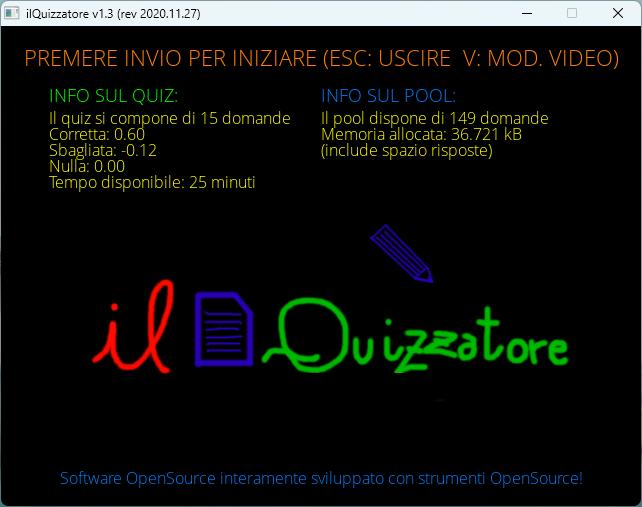

# ilQuizzatore2020
An old desktop C++/SDL2-based quiz simulator.

# About the project
I built this software in 2020 when i was studying chemistry during my bachelor degree using what I studied in my programming course: the result was a DIY program: it isn't a state-of-the-art project so it doesn't strictly follow OOP best practices (that I hadn't studied yet). Feel free to fork and improve this project!

# Libraries:
SDL2, SLD2_image, SDL2_ttf

# Building from Source
To compile the application on Linux (or Windows using MSYS2), run:
```bash
g++ main.cpp -I . -lSDL2 -lSDL2_ttf -lSDL2_image -no-pie -o run -Wall
```

# Preview:

